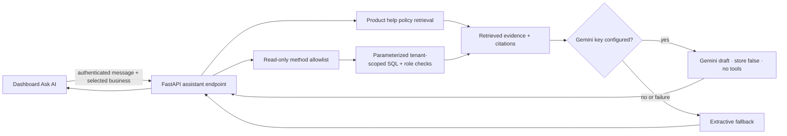

# PlaceURorder Ask AI, Product Policy, and Docker Plan

Prepared: 2026-10-11
Status: implementation underway; this plan now records the delivered first slice and the remaining launch work.

## What this repo does

PlaceURorder is a multi-tenant restaurant platform with a Next.js dashboard, kiosk, counter POS, kitchen display, and a FastAPI/Postgres backend. Supabase provides authentication and the checked-in database migrations; the app also has local Docker Compose support and a separate webhook delivery worker. I assumed a small-to-medium restaurant deployment with multiple businesses and devices, and that tenant privacy, order/payment correctness, and recovery from a service outage matter more than adding broad autonomous actions.

## Current project map

- Frontend: Next.js App Router; dashboard navigation and selected business/location state are shared through `AppShell` and `BusinessProvider`.
- Backend: 259 declared API operations across auth, business setup, menu, orders, payments, devices, kitchen, analytics, integrations, and administration.
- Access control: authenticated routes use `require_user_id`; business-scoped services use role checks such as `assert_business_access`.
- Data: Supabase Auth and SQL migrations, with Postgres access through the backend. Public kiosk endpoints are intentionally separate from authenticated dashboard APIs.
- AI: the dashboard assistant retrieves product-guide passages and allowlisted, role-checked live data. Optional Gemini generation runs only when a server-side key is configured; the no-key/error path remains extractive.
- Containers: `compose.yaml` and frontend/backend Dockerfiles exist. The Podman-compatible stack now includes Postgres, API, frontend, and webhook worker on localhost.

## Findings that shape the plan

### Container reliability

1. **Fixed in this slice:** Compose now starts `backend/webhook_worker.py` against the same local database, so queued webhook events have a delivery consumer.

### Should fix before broad rollout

2. **There are multiple schema boot paths.** Compose initializes from `backend/postgres_schema.sql` and enables runtime compatibility SQL; the Supabase migration chain lives under `supabase/migrations`. The initial migration declares 47 tables while the Docker snapshot declares 44; compatibility SQL fills at least some gaps. Fresh local and hosted databases can therefore diverge as features are added. Pick one canonical migration path and verify both fresh setup and upgrades against it.

3. **The API is too broad to hand to a model wholesale.** It contains 259 operations, including destructive, payment, staff, device, and security operations. Giving an LLM the full OpenAPI spec or a generic HTTP caller would create unnecessary access and prompt-injection risk. Start with a small server-enforced read-only allowlist.

4. **Setup instructions describe different database arrangements.** The root README describes local Postgres plus optional Supabase authentication; the backend README describes Supabase Postgres/Auth as the normal setup. Document one supported local workflow and one production workflow, with clear required environment variables.

5. **Runtime and development dependency results differ.** The current production dependency audit (`npm audit --omit=dev`) reports zero vulnerabilities. The full tree reports five high-severity findings in the ESLint/Next lint dependency chain. Review and update that development toolchain without applying npm's suggested major downgrade blindly. Python requirements are unpinned, so container builds may resolve different versions over time.

## Recommended product scope

Keep two different sources: the **PlaceURorder Product Help Policy** is the source of truth for product answers; the **Terms and Conditions** and **Privacy Notice** are separate legal drafts. The legal drafts are explicitly not effective and must not be published or used for acceptance until operator/entity details and legal review are complete.

Ask AI is dashboard-only. It retrieves cited product-guide passages and can read limited live business setup, catalog, rolling 24-hour order counts, and paid-sales aggregates after tenant and role checks. If a server-side Gemini key is configured, it sends only the question and those retrieved excerpts to Gemini for a concise answer; otherwise it returns extractive evidence. Gemini has no tools or direct database/API access. It cannot change settings, publish, manage staff, alter payments, refund orders, or query arbitrary SQL/URLs. A standards-compatible external MCP server remains deferred.

## Ask AI design

1. `POST /api/assistant/chat` requires the existing authenticated session, a valid business membership, a 1,000-character question limit, and the shared rate limiter.
2. The internal method allowlist currently contains scoped menu, order-count, sales-aggregate, and business-setup reads. SQL is parameterized and always bound to the authorized business. Order reads omit customer fields and notes.
3. The product guide is ranked lexically and returned as short, versioned excerpts. Live sources include their retrieval timestamp. If no source matches, the response says so instead of fabricating an answer.
4. The panel discloses that Gemini may receive the question and matching authorized business facts. The model key stays in the backend, interactions use `store: false`, and the panel still shows source citations. The application does not persist chat; requests are cancelled when the business changes or the panel closes.
5. Gemini receives no tools or database/API access; every live read remains enforced by the existing server-side allowlist, tenant boundary, and role checks. Write actions remain out of scope.

## Product policy document

The implemented versioned source is `backend/knowledge/placeurorder-help-policy.md`. Keep it accurate to shipped behavior, not marketing claims. A separate draft terms and privacy notice lives under `docs/legal/`.

- Product scope, supported business types, devices, and terminology.
- Signup, business selection, onboarding, setup, test, preview, and publish flows; clearly distinguish test data from live orders.
- Dashboard areas: menu, modifiers, branding, availability, promotions, locations, analytics, orders, kitchen, counter, and devices.
- Payment methods and provider setup, with explicit prerequisites and unsupported cases; never promise a payment/refund capability unless the app implements it.
- Roles, permissions, and safe troubleshooting steps.
- FAQs with numbered steps, role prerequisites, expected result, common failure messages, and escalation guidance.
- Explicit answer boundaries: do not invent prices, SLAs, legal interpretations, hardware guarantees, or provider status. Say when the guide does not contain an answer.
- Document owner, version, last-reviewed date, and links to the relevant app screens/API behavior.

The lookup returns sections as evidence. Optional Gemini generation is disclosed in the separate privacy and terms review drafts; neither draft is effective until the marked legal and operational details receive review. Do not label product help text as contractual terms.

## Docker and deployment plan

The repository already has container files, so the work is to make the supported workflow complete and repeatable:

- Keep a local development Compose profile with `db`, `api`, `frontend`, and `webhook-worker`. Preserve localhost-only port bindings and named data volumes. Keep development credentials clearly local-only and out of production deployment instructions.
- Make schema initialization deterministic: one canonical migration chain, run once before the API/worker start; do not rely on a mutable schema snapshot plus startup compatibility SQL as two independent sources of truth.
- Make Supabase Auth configuration explicit in the local setup. If credentials are absent, show a clear disabled-auth state in docs/UI; do not imply authenticated flows work offline when they require Supabase.
- Pin backend dependencies with a committed lock/constraints file; keep `npm ci` and the committed `package-lock.json` for the frontend. Pin base image versions and update them through a routine security review.
- Keep API and worker non-root; API has a health check and worker restarts if it exits. Use managed Postgres/Supabase and secret storage for production; do not run local Compose credentials as production infrastructure.
- Align upload storage and email behavior by environment: local volumes/outbox for development, supported persistent/managed services for production.
- Update the root and backend READMEs with the same commands, variable names, database/auth diagram, migration procedure, backup/restore note, and “local versus production” boundary.

## Delivery phases and acceptance

### Phase 1 — Foundation

- Reconcile the local/hosted schema path and document the chosen Supabase/Auth setup.
- [x] Add the webhook worker to Compose and make its database dependency explicit.
- Pin backend dependencies and make the local environment template complete.
- Acceptance: a new developer can follow one documented setup; database migrations apply cleanly to a fresh database; queued webhook deliveries are processed when configured; existing auth and business access rules are unchanged.

### Phase 2 — Product and legal policy

- [x] Draft and version the help policy from observed onboarding, menu, test/publish, role, order, and payment behavior.
- [x] Create review-only Terms and Privacy drafts using the supplied name, email, and country; unresolved legal details remain conspicuous.
- Review product claims with the product owner and obtain legal review before making either legal draft effective.
- Acceptance: a fixed set of real merchant questions has a supported answer, a cited section, or an explicit “not documented” response.

### Phase 3 — Read-only Ask AI MVP

- [x] Add authenticated retrieval route, explicit read-only method allowlist, dashboard side panel, input/rate limits, source citations, and no prompt persistence.
- [x] Add optional server-side Gemini generation with no-key/provider-failure extractive fallback; no tool calling or arbitrary SQL/API access.
- [ ] Verify tenant isolation, per-role access, menu search, supported/unsupported date windows, and response behavior before rollout.

### Phase 4 — Reliability and rollout

- Verify AI answers against the policy Q&A set and tests for tenant isolation, permissions, prompt injection, provider failure, and rate limits.
- Verify Docker from a clean checkout and fresh database, then test restart, persistent data, worker retries, and backups.
- Add CI checks for frontend/backend dependency audits, schema/migration setup, container builds, and the existing app test suites.
- Roll out behind a feature flag to internal users first; review answer quality, latency, provider cost, and error rates before enabling for all dashboard users.

## Decisions confirmed for this implementation

- The requested policy means legal Terms and Conditions; a separate product help guide is needed for grounded Ask AI answers.
- Gemini was selected for optional generated answers, with extractive fallback. No key is stored in source control; generation remains off until the backend environment key is configured.
- Live answers use a small internal, read-only method allowlist; there is no arbitrary SQL, URL, or broad API access.
- Legal operator name/email/country supplied: Jithendra Muttum, muttumjithendra@gmail.com, India. Legal entity capacity, business address, and city/state court venue are not supplied.
- Docker Compose is for local development/CI. Production continues to use managed database/auth and deployment infrastructure unless a separate production-container target is requested.

## Remaining checks and known limits

- I did not read every route/service implementation; I mapped the whole route surface and traced shared auth/business authorization, app shell, schema setup, Docker services, and webhook worker paths in depth.
- Backend suite: 233 passed, 3 live-Postgres tests skipped; frontend lint, typecheck, and stylesheet checks passed. Compose parsing passed, but the stack has not been built or started.
- No real Gemini request was sent because no key was supplied to this task. The provider request is covered with a mocked response and network-failure fallback tests.
- Podman 6.0.2 is installed and the machine is running; `podman compose config` parses the current stack through its installed external provider.
- The local/hosted schema boot paths still differ, backend Python dependencies remain unpinned, and dependency audits/clean-container restart and backup checks remain open.
- The legal files are drafts only; no public acceptance links were added. Obtain legal review and complete the marked identity, address, pricing, retention, subprocessor, grievance, and venue details.
- Ask AI does not implement the standard MCP wire protocol; its internal retrieval and read methods are intentionally narrow. A real Gemini request requires testing with an owner-provided server-side key and review of Google account data-use terms.

**Current status:** Podman Compose includes the webhook worker, review-only legal drafts exist, and the dashboard has tenant-scoped retrieval with optional Gemini 3.1 Flash-Lite generation. No key is committed; generation stays extractive until a backend environment key is supplied. Complete provider, live-DB, container, and legal checks before production use.
